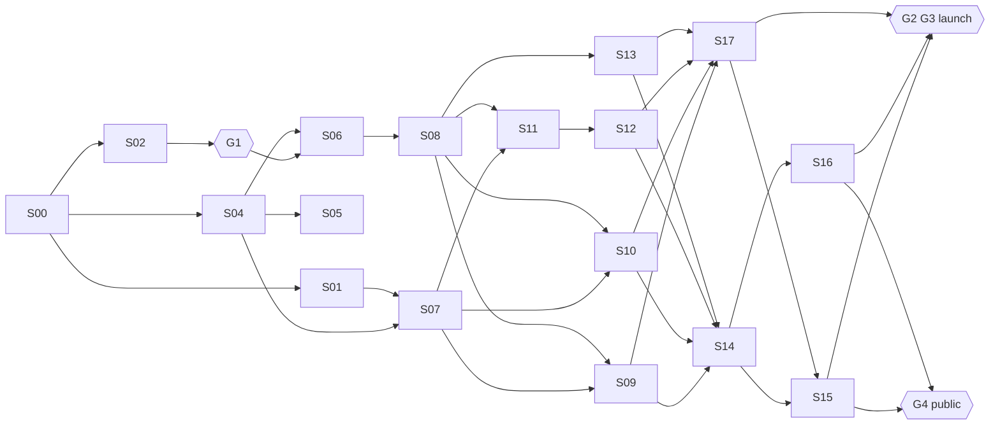

# Implementation Plan (v2)

The master roadmap.

**Supporting files:**

- Evidence: `AUDIT.md`
- Choices: `DECISIONS.md`
- How it's built: `ARCHITECTURE.md`, `MULTILINGUAL.md`
- What it says: `CONTENT_STRATEGY.md`
- How it looks: `DESIGN_BRIEF.md`
- How it's checked: `TEST_STRATEGY.md`
- Where we are: `HANDOFF.md`

## 1. Goal and success criteria

Evolve the `abuobaida` theme into a modern, trilingual (Arabic, English, Chinese), accessible and fast classic WordPress theme that presents real projects as case studies. Publish it as a clean public repository, without losing any existing feature or content.

| Criterion | Measure | Baseline (S00) |
|---|---|---|
| Valid documents | 1 doctype/html/head/body/title per page; one `<h1>` | Home: 2 of each; posts and pages: no `<body>` |
| Robust | No fatal error or warning with any plugin off or any field empty | HTTP 500 without ACF; 6 warnings |
| Readable without JS | 100% of content visible | 0% of homepage sections |
| Trilingual | en, ar (RTL) and zh, each complete and reviewed | English only |
| Accessible | axe: 0 serious/critical. Keyboard-complete. Text contrast ≥ 4.5:1 | 7 failing rules on home; accent 3.0:1 |
| Lean | Theme JS ≤ 20 KB, CSS ≤ 60 KB, 0 third-party requests on load | 433 KB JS, 355 KB CSS, 8 third-party requests |
| Real content | ≥ 4 real projects, ≥ 1 full case study | 0 |
| Publishable | No third-party-licensed template code. Clean lint. README, CHANGELOG, LICENSE | iPortfolio free; 650 PHPCS errors |

## 2. Strategy in one table

| Keep | Replace | Add |
|---|---|---|
| Theme slug and text domain, template hierarchy, `_s` supports that are used, ACF data (migrated), CF7, the Mostaql reviews, the 404 concept, every feature in §3 | iPortfolio markup, CSS and JS; the slug-bound homepage; the split headers and footers; all `assets/vendor`; physical CSS; skill bars and animations | `front-page.php`; `theme.json`; the companion plugin (`project`, `testimonial`); Polylang integration; design tokens; QA tooling; CI; docs |

## 3. Feature inventory: preserve or retire by decision

| ID | Feature | Today | v2 | Session |
|---|---|---|---|---|
| F-01 | Hero: name and roles | Hard-coded; Typed.js | Name in three scripts; statement field; no animation (D-15) | S09 |
| F-02 | About | ACF `about` | One-line intro on home; full `/about/` page (block content) | S09, S13 |
| F-03 | Skills | Hard-coded % bars | Capabilities = `project_type` terms (D-24) | S07, S09 |
| F-04 | Portfolio grid, filter, lightbox | Placeholders; Isotope; GLightbox | Featured projects on home; `/projects/` with link-based filter; core lightbox | S09, S11 |
| F-05 | Project details | Broken link | `single-project.php` case study | S12 |
| F-06 | Testimonials | `cb/carousel` blocks | `testimonial` post type; static accessible list (D-09) | S07, S10 |
| F-07 | Contact | ACF `contact_us`, CF7 #138, map iframe | Per-language form via field; map on click or a link (D-20) | S10 |
| F-08 | Navigation | Fixed sidebar, hard-coded anchors | `wp_nav_menu` per language; disclosure menu on phones; skip link | S08 |
| F-09 | Social links and photo | Hard-coded, dead | Customizer URLs (only real ones); optional photo (Q-10) | S08, S10 |
| F-10 | Résumé download | Hard-coded uploads URL | File field per language | S10 |
| F-11 | Back to top | JS + icon font | Plain anchor link | S08 |
| F-12 | 404 | Terminal, remote GIF | Terminal concept, local, translatable | S13 |
| F-13 | Blog templates | Broken | Working and styled (D-07) | S13 |
| F-14 | `_s` supports (title-tag, logo, background, header, Customizer, widgets) | Present | Keep what's used; unused ones retired with the owner's approval | S06 |
| F-15 | Translation readiness | `.pot` with `_s` leftovers | Full theme i18n; ar and zh_CN `.po`/`.mo` | S06, S17 |

## 4. Gates

| Gate | Opens | Requires | Who |
|---|---|---|---|
| **G0 Plan accepted** | Everything | This plan and the D-entries marked 🟡 reviewed (accept or amend) | Owner |
| **G1 Design approved** (D-18, confirmed) | S06 onward (any UI code) | DESIGN_BRIEF §5 checklist | Owner |
| **G2 Content ready** | S18 launch | ≥ 4 real projects (≥ 1 case study), About text, permissions (Q-11), translations reviewed | Owner |
| **G3 Release ready** | S18 | S15 and S16 pass the definition of done; rollback rehearsed on staging | Owner + Claude |
| **G4 Go public** | S19 push | Licence chosen (Q-01); history decision (D-26); secret and PII scan clean | Owner |

## 5. Sessions

**Sizes:** S ≈ one short session, M ≈ one full session, L ≈ a full session that may need a follow-up.

| # | Session | Phase | Size | Depends on | Gate / owner input |
|---|---|---|---|---|---|
| 00 | Audit and planning v2, pre-design canvas | 0 | L | — | ✅ done |
| 01 | Production inventory: exports, hosting facts, content intake | 0 | S | 00 | Q-02, Q-03, Q-04, Q-08, Q-12 |
| 02 | Design direction review and selection | 1 | M | 00 | Owner feedback on the canvas |
| 03 | Full design set for the chosen direction (all templates, three languages, states) → **G1** | 1 | L | 02 (01 helps) | G1 |
| 04 | Repo hygiene, dev tooling, CI | 2 | M | 00 | — |
| 05 | Optional hotfix of the live v1 theme (D-22) | 2 | M | 04 | Owner decides to deploy |
| 06 | v2 foundation: branch, structure, `theme.json` tokens, fonts, base CSS, asset loader, i18n adapter | 2 | L | 03 (G1), 04 | — |
| 07 | Companion plugin and content model (CPTs, taxonomies, ACF JSON, helpers, fixtures) | 2 | M | 01, 04 | Q-08 |
| 08 | Site shell: header, navigation, language switcher, footer, RTL | 3 | M | 06 | Q-07, Q-12 |
| 09 | Homepage I: hero, selected work, capabilities | 4 | M | 07, 08 | Q-02, Q-09, Q-10 |
| 10 | Homepage II: testimonials, contact, résumé, map | 4 | M | 07, 08 | Q-11, Q-13 |
| 11 | Projects archive and filter | 5 | M | 07, 08 | — |
| 12 | Project case study | 5 | M | 11 | — |
| 13 | Other templates: page/About, posts, archive, search, comments, 404 | 6 | M | 08 | Q-05 |
| 14 | Performance, vendor removal, asset and licence clean-up | 7 | M | 09–13 | — |
| 15 | Accessibility and cross-language QA, regression against §3 | 7 | M | 14, 17 (draft) | Owner screen-reader pass |
| 16 | Security and compatibility review (PHP 8.1–8.5, WP 6.6/7.1, plugins off) | 7 | S | 14 | — |
| 17 | Translations and content entry (ar, zh) | 8 | M | 09–13 | Q-06; owner review |
| 18 | Staging rehearsal, migration, launch, rollback plan | 8 | M | 15, 16, 17, **G2**, **G3** | Owner deploys |
| 19 | Public repository release (README, CHANGELOG, LICENSE, history and secret scan) | 8 | M | 15, 16, **G4** | Owner approves the push |

**Critical path:** S02 → S03 (G1) → S06 → S08 → S09/S10/S11 → S14 → S15 → S18.
**Parallel tracks:** S01 (owner), S04 → S05, and S07 can all run while the design is being reviewed.
**Recommended next:** **S02** (design review, the owner is waiting on it) and **S04** (needs no owner input).

## 6. Ranked improvements

| Rank | Improvement | Fixes | Sessions |
|---|---|---|---|
| 1 | Replace the licence-encumbered iPortfolio layer and its stock assets | P-01 | 06–14 |
| 2 | Valid, robust document shell and ACF guards (hotfix now, then v2) | P-02, P-03, P-05 | 05, 06, 08 |
| 3 | Content visible without JS; no motion the visitor didn't trigger | P-04 | 05, 09 |
| 4 | Real project content model and case studies | P-06 | 07, 09, 11, 12 |
| 5 | Trilingual with correct RTL | P-07 | 06, 08, 17 |
| 6 | Keyboard and screen-reader access; AA contrast | P-08 | 08–13, 15 |
| 7 | Personal data minimised | P-09 | 01, 09, 10 |
| 8 | Weight: no framework, self-hosted fonts, conditional assets | P-10 | 06, 14 |
| 9 | No environment-bound URLs or IDs | P-11 | 05, 07, 10 |
| 10 | Standards, dead code and repository hygiene | P-12–P-15 | 04, 14, 19 |

## 7. Branching and review

- `master` is production. Only S05 (the optional hotfix) lands there before launch.
- `v2` is the integration branch, created in S06 from `master` after S04 is merged.
- Each session works on `feature/NN-slug`, branched from `v2` (or from `master` for S04 and S05). The owner reviews the diff, then it merges locally.
- **Nothing is pushed, released or published without the owner's explicit approval** (brief §7). Claude prepares the commands; the owner runs them or authorises them.

## 8. Release, migration and rollback (detailed in S18)

1. **Before:** full backup (database and `wp-content`); confirm PHP 8.3+; staging copy if the host offers one.
2. **Install:** the companion plugin, then Polylang (configured per MULTILINGUAL §2), then the core ar and zh_CN language packs.
3. **Content:**
   - assign English to existing content;
   - create the ar and zh front pages and fill their fields;
   - create per-language CF7 forms and menus;
   - enter projects and testimonials;
   - migrate the `about` and `contact_us` values.
4. **Switch:** deploy theme v2.0.0. The slug is the same, so it's a file deployment and the active theme doesn't change.
5. **Verify:** run the S15 checklist on production in three languages; check forms send; check `debug.log` is quiet.
6. **Rollback:**
   - redeploy the v1.x files (kept as a zip);
   - the v1 homepage still works because its slug `home` and its ACF fields remain;
   - the new post types are simply hidden by v1;
   - Polylang can stay active or be deactivated: translations become separate posts.
   - **No step deletes v1 data** until 30 days after launch.

## 9. Risk register

| ID | Risk | Likelihood | Impact | Mitigation | Owner |
|---|---|---|---|---|---|
| R-01 | Real project content isn't ready, so the site launches with placeholders | High | High | Gate G2; the questionnaire in CONTENT_STRATEGY §8; launch with ≥ 4 items; case studies can be "lite" | Owner |
| R-02 | Host on PHP < 8.3, so CF7 can't update | Medium | Medium | Q-03 in S01; ask the host to upgrade; the theme itself needs only 8.1 | Owner |
| R-03 | Polylang free limits (no field sync) make editing tedious | Medium | Low | Few fields; shared testimonials; documented workflow | Claude |
| R-04 | Arabic or Chinese translations are poor | Medium | High | Drafts are marked; owner or native review before publishing; glossary | Owner |
| R-05 | RTL regressions creep in | Medium | Medium | Logical-CSS check in CI; Arabic screenshots in every UI session | Claude |
| R-06 | IP and permissions (template, photos, client names, reviews) | Medium | High | S14 asset audit; Q-10 and Q-11 permissions; D-26 history decision | Owner + Claude |
| R-07 | Migration breaks the live site | Low | High | Staging rehearsal; backups; rollback (§8); same theme slug | Owner |
| R-08 | Scope creep (blog features, dark mode, animations) | Medium | Medium | Out-of-scope lists in every session; new ideas go to DECISIONS first | Both |
| R-09 | Tooling blocked in a Claude session (Packagist, npm) | High | Low | GitHub-only recipes, proven in S00 (`qa/README.md`) | Claude |
| R-10 | No upstream for the Underscores scaffold | Certain | Low | We own the code; `_s` naming removed in S04 and S06 | Claude |
| R-11 | CJK fonts slow or inconsistent | Low | Low | System CJK stack (D-10) | Claude |
| R-12 | SEO dip from URL and structure changes | Low | Medium | English stays at `/`; hreflang; sitemaps checked in S08 and S18 | Claude |
| R-13 | Contact form spam | Medium | Low | Q-13 choice in S10 | Owner |
| R-14 | Long-lived `v2` branch drifts from `master` | Low | Low | The hotfix is small and rebased once | Claude |

## 10. Out of scope, unless decided otherwise

- A block theme or Site Editor migration (D-02).
- Dark mode (D-11).
- A blog redesign beyond styling (D-07).
- E-commerce.
- A page builder.
- Analytics (owner's choice, separate).
- Anything to do with the Dropshipping OMS project (D-04).

## 11. Progress log

| Date | Session | Result |
|---|---|---|
| 2026-10-14 | 00 v1 | First audit and plan, from reading the code. |
| 2026-10-14 | 00 v2 | Measured audit on a local WordPress 7.1.3; PHPCS and PHPCompatibility run; Polylang spike; platform facts checked; pre-design canvas with 3 directions (10 artboards); plan, decisions, architecture, multilingual, content, design and test docs rewritten; local-environment recipe tested from scratch. Committed locally on `docs/modernization-plan`, not pushed. |
